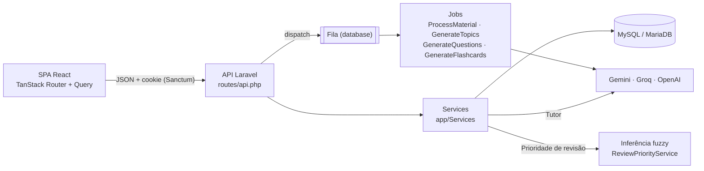

# Nexora

Plataforma de estudos que transforma os materiais de aula do estudante (PDF, Word e PowerPoint) em tópicos, resumos, flashcards e questões, usando IA generativa. Ela prioriza o que revisar com um **sistema de inferência fuzzy de Mamdani**.

Projeto acadêmico da disciplina de **Inteligência Artificial** do curso de Ciência da Computação. O tema da disciplina aplicado aqui é a **lógica fuzzy**: a IA generativa produz o conteúdo, e a lógica fuzzy decide a prioridade de revisão de cada tópico.

## Sumário

- [Funcionalidades](#funcionalidades)
- [Lógica fuzzy: prioridade de revisão](#lógica-fuzzy-prioridade-de-revisão)
- [IA generativa](#ia-generativa)
- [Arquitetura](#arquitetura)
- [Stack](#stack)
- [Estrutura do projeto](#estrutura-do-projeto)
- [Como rodar localmente](#como-rodar-localmente)
- [Variáveis de ambiente](#variáveis-de-ambiente)
- [Qualidade de código](#qualidade-de-código)
- [Deploy com Docker](#deploy-com-docker)
- [API](#api)
- [Limitações conhecidas](#limitações-conhecidas)

## Funcionalidades

- **Disciplinas e biblioteca de materiais.** Upload de PDF, DOCX e PPTX (até 10 MB). O texto é extraído e resumido em segundo plano.
- **Árvore de tópicos gerada por IA.** Até 3 níveis, com um resumo didático por tópico.
- **Flashcards por tópico**, com revisão espaçada pelo algoritmo **SM-2**.
- **Questões de múltipla escolha por disciplina**, com explicação da resposta.
- **Sessão de estudo** que embaralha os flashcards com revisão vencida e as questões ainda não respondidas ou erradas nos últimos 30 dias.
- **Tutor IA:** um chat com o contexto da disciplina ou de um tópico.
- **Desempenho:** taxa de acerto ao longo do tempo, sequência de dias estudados e **áreas de atenção** priorizadas por lógica fuzzy. Uma página mostra o passo a passo da inferência.
- **OCR de PDF escaneado:** quando o PDF não tem texto, o próprio arquivo é enviado ao modelo (Gemini ou OpenAI) para transcrição.
- **Provedor de IA por estudante:** Gemini, Groq ou OpenAI, com a chave própria do estudante (criptografada) ou a do servidor.
- **Página "Como usar"**, um manual para quem não é da área de tecnologia.

## Lógica fuzzy: prioridade de revisão

A implementação está em [`app/Services/ReviewPriorityService.php`](app/Services/ReviewPriorityService.php): um sistema de inferência de **Mamdani** escrito do zero, sem bibliotecas.

### Variáveis linguísticas

Cada termo é uma função de pertinência trapezoidal `[a, b, c, d]`. O triângulo é o caso `b = c`. Os termos vizinhos formam uma partição: a soma dos graus é 1 em todo o universo.

| Variável | Universo | Termos |
|---|---|---|
| **acerto** (entrada) | 0 a 100 % | baixo `[0, 0, 25, 50]` · médio `[25, 50, 50, 75]` · alto `[50, 75, 100, 100]` |
| **recência**: dias desde a última tentativa (entrada) | 0 a 30 dias | recente `[0, 0, 3, 10]` · média `[3, 10, 10, 17]` · antiga `[10, 17, 30, 30]` |
| **prioridade** (saída) | 0 a 100 | baixa `[0, 0, 25, 50]` · média `[25, 50, 50, 75]` · alta `[50, 75, 100, 100]` |

Valores fora do universo são levados à borda mais próxima: 45 dias contam como 30.

### Base de regras

São 9 regras, uma para cada combinação, no formato `SE acerto é X E recência é Y ENTÃO prioridade é Z`:

| acerto \ recência | recente | média | antiga |
|---|---|---|---|
| **baixo** | média | alta | alta |
| **médio** | baixa | média | alta |
| **alto** | baixa | baixa | média |

### Inferência

1. **Fuzzificação:** o grau de cada entrada em cada termo.
2. **Avaliação das regras:** o `E` é o **mínimo** dos graus. Cada termo de saída recebe o **máximo** entre as regras que levam a ele.
3. **Agregação:** cada termo de saída é **cortado** no grau da sua ativação (implicação de Mamdani por mínimo), e os cortes são unidos pelo **máximo**.
4. **Defuzzificação:** pelo **centróide discreto** `Σ z·μ(z) / Σ μ(z)`, amostrado em 101 pontos (`z = 0, 1, …, 100`). O rótulo final é o termo de saída com o maior grau no centróide.

### Exemplo resolvido: 40 % de acerto e última tentativa há 12 dias

| Passo | Resultado |
|---|---|
| Fuzzificação | acerto: baixo 0,4 · médio 0,6 · recência: média 5/7 ≈ 0,71 · antiga 2/7 ≈ 0,29 |
| Regras disparadas | baixo∧média → alta 0,4 · baixo∧antiga → alta 0,29 · médio∧média → média 0,6 · médio∧antiga → alta 0,29 |
| Ativação | média 0,6 · alta 0,4 |
| Centróide | **≈ 62,9**, que pertence a média com grau 0,484 e a alta com grau 0,516: prioridade **alta** |

### Onde a prioridade é usada

- **Áreas de atenção**, em `/desempenho`: os tópicos com maior prioridade de revisão.
- **Ordem das questões recomendadas:** primeiro os tópicos com prioridade *alta*, depois os nunca praticados e, por fim, o restante em ordem decrescente de prioridade.
- **Explicação visual**, em `/desempenho/prioridade`: as funções de pertinência, a matriz de regras com as células disparadas e os 4 passos da inferência para cada tópico, incluindo o conjunto agregado e a linha do centróide.
- **Endpoint `GET /api/review-priority`**, que devolve o sistema descrito como dados e a inferência de cada tópico praticado.

## IA generativa

As chamadas aos modelos usam o pacote [`laravel/ai`](https://github.com/laravel/ai). Cada estudante tem **um provedor ativo** que responde todas as tarefas. Quem não escolheu nenhum usa o padrão do app (`AI_PROVIDER`).

| Provedor | Modelo | Lê PDF (OCR) |
|---|---|---|
| Google Gemini | `gemini-3.5-flash` | sim |
| Groq | `openai/gpt-oss-120b` | não |
| OpenAI | `gpt-5.6-terra` | sim |

| Tarefa | Onde | Execução |
|---|---|---|
| Resumo do material | `FileService::generateSummary` | job `ProcessMaterial` |
| OCR de PDF escaneado | `FileService::transcribeScannedPdf` | job `ProcessMaterial` |
| Árvore de tópicos | `GenerateTopics` | fila |
| Questões | `GenerateQuestions` | fila |
| Flashcards | `GenerateFlashcards` | fila |
| Tutor | `TutorService` | requisição HTTP |

Detalhes:
- **Fila:** as gerações rodam no driver `database`, com novas tentativas. As falhas viram mensagens amigáveis (`AiFailureMessageService`), como chave recusada, limite de uso ou provedor sobrecarregado.
- **Limite de uso:** as rotas de geração passam pelo rate limiter `ai-generation`, de 10 pedidos por minuto por estudante.
- **Chave do estudante:** fica na coluna `users.ai_api_key`, com o cast `encrypted`. Ela nunca é serializada nem devolvida pela API.
- **Extração de texto:** PDF com `smalot/pdfparser`. DOCX e PPTX são lidos direto dos XML do pacote OOXML, com `ZipArchive` e `DOMDocument`, sem conversão para PDF nem serviços externos.

## Arquitetura



- **Backend:** uma API JSON em Laravel. Os controllers são finos, e a lógica fica em `app/Services`. A autorização usa Policies e route model binding.
- **Frontend:** uma SPA em React servida pelo próprio Laravel (rota *catch-all* em `routes/web.php`). A autenticação é a de SPA do Sanctum, com cookie de sessão e CSRF (`statefulApi()`).
- **Tarefas longas** (processar materiais e gerar conteúdo) rodam na fila. A tela consulta o status (`processing`, `ready` ou `failed`) até a tarefa terminar.

## Stack

| Camada | Tecnologias |
|---|---|
| Backend | PHP 8.3+, Laravel 13, Sanctum 4, laravel/ai, smalot/pdfparser |
| Frontend | React 19, TypeScript, Vite 8, TanStack Router e Query, Tailwind CSS 4, Recharts, Base UI / shadcn |
| Banco e fila | MySQL / MariaDB; fila com o driver `database` |
| Qualidade | Laravel Pint |
| Deploy | Docker (FrankenPHP + Caddy, HTTPS automático) e MariaDB |

## Estrutura do projeto

```
app/
├── AiProvider.php              # provedores de IA, modelos e suporte a PDF
├── Http/Controllers/           # controllers finos da API
├── Jobs/                       # tarefas de IA executadas na fila
├── Models/
├── Policies/
└── Services/                   # regras de negócio
    ├── ReviewPriorityService.php   # inferência fuzzy de Mamdani
    ├── AiProviderService.php       # provedor ativo e chave do estudante
    ├── FileService.php             # extração de texto, OCR e resumo
    ├── QuestionService.php         # questões e recomendação
    ├── FlashcardService.php        # flashcards e SM-2
    └── ...
resources/js/
├── routes/                     # páginas da SPA (rotas por arquivo, TanStack Router)
├── components/                 # componentes, como o gráfico de pertinência fuzzy
└── lib/api.ts                  # cliente HTTP (axios)
docker/                         # Caddyfile e php.ini de produção
```

## Como rodar localmente

**Pré-requisitos:**
- PHP 8.3 ou superior, com as extensões `pdo_mysql`, `zip`, `intl`, `mbstring`, `dom` e `fileinfo`;
- Composer;
- Node.js 22.12 ou superior;
- MySQL ou MariaDB.

```bash
git clone https://github.com/filipi2601/nexora.git
cd nexora

composer install
cp .env.example .env
php artisan key:generate
```

No `.env`, configure:
- o banco, em `DB_*`;
- pelo menos uma chave de IA, em `GEMINI_API_KEY`, `GROQ_API_KEY` ou `OPENAI_API_KEY`;
- o provedor padrão, em `AI_PROVIDER`.

Depois:

```bash
php artisan migrate --seed
php artisan storage:link

npm install --ignore-scripts
composer run dev
```

O `composer run dev` sobe juntos o servidor (`php artisan serve`), o processo da fila (`queue:listen`) e o Vite. Sem a fila, os materiais não são processados e as gerações não acontecem.

O seeder cria usuários de demonstração; as credenciais estão em [`database/seeders/UserSeeder.php`](database/seeders/UserSeeder.php). **Não rode o seeder em produção.**

## Variáveis de ambiente

Além das variáveis padrão do Laravel (`APP_*`, `DB_*`, `SESSION_*`):

| Variável | Descrição |
|---|---|
| `QUEUE_CONNECTION` | `database`. As tarefas de IA dependem da fila |
| `AI_PROVIDER` | Provedor padrão: `gemini`, `groq` ou `openai` |
| `GEMINI_API_KEY`, `GROQ_API_KEY`, `OPENAI_API_KEY` | Chaves do servidor; o estudante pode usar a própria |
| `DB_QUEUE_RETRY_AFTER` | Em produção, `3700`. A geração de tópicos pode levar até 1 hora, e o padrão (90 s) faria o job rodar de novo |

## Qualidade de código

O código PHP segue o padrão do Laravel Pint:

```bash
vendor/bin/pint
```

## Deploy com Docker

Os arquivos de produção ficam separados dos de desenvolvimento. O `compose.yaml` é do Laravel Sail e serve só para desenvolvimento.

| Arquivo | Função |
|---|---|
| `Dockerfile` | Build em duas etapas: os assets com Node e a imagem final com FrankenPHP e as extensões PHP |
| `compose.prod.yaml` | Serviços `app` (web, com HTTPS automático), `queue` (worker da fila) e `db` (MariaDB), com volumes para os uploads, o banco e os certificados |
| `docker/Caddyfile` | Servidor web; o domínio vem de `SERVER_NAME` |
| `docker/php.ini` | Limites de upload e memória |

No servidor, com o `.env` de produção (`APP_ENV=production`, `APP_DEBUG=false`, `DB_HOST=db`, `SERVER_NAME` e `APP_URL` com o domínio):

```bash
docker compose -f compose.prod.yaml up -d --build
```

Cada vez que o container `app` sobe, ele cria o link do storage, gera o cache da configuração e roda as migrations. O app não tem tela de cadastro; crie os usuários com `php artisan tinker` dentro do container.

## API

Todas as rotas ficam sob `/api` e, exceto `login` e `register`, exigem autenticação (Sanctum).

| Grupo | Rotas principais |
|---|---|
| Autenticação | `POST /login` · `POST /logout` · `GET/PUT /user` |
| Configurações de IA | `GET/PUT /user/ai-settings` · `DELETE /user/ai-key` |
| Disciplinas e tópicos | `GET/POST /subjects` · `GET /subject/{slug}` · `GET /subject/{slug}/topic/{topicSlug}` · `POST /subjects/{id}/regenerate-topics` |
| Materiais | `GET /materials` · `POST /material` · `POST /material/{id}/reprocess` · `DELETE /material/{id}` |
| Flashcards | `GET /flashcards` · `POST /flashcards/generate/{topicId}` · `POST /flashcards/{id}/review` |
| Questões | `GET /questions/recommended` · `GET /questions/wrong` · `POST /subjects/{slug}/questions/generate` · `POST /questions/{id}/answer` |
| Sessão de estudo | `POST /study-sessions` · `POST /study-sessions/{id}/finish` |
| Desempenho | `GET /dashboard` · `GET /performance` · `GET /review-priority` |
| Tutor | `GET/POST /tutor/conversations` · `POST /tutor/conversations/{id}/messages` |

As rotas de geração (tópicos, questões, flashcards e reprocessamento) passam pelo limite de 10 pedidos por minuto.

## Limitações temporárias

- **Contas:** não há telas de cadastro nem de recuperação de senha. Os usuários são criados pelo seeder, pelo `tinker` ou pelo endpoint `POST /api/register`.
- **Lembretes de estudo:** a preferência é salva, mas nenhum lembrete é enviado (não há agendamento nem envio de e-mail).
- **Simulados:** aparecem como "em breve".
- **OCR:** depende de o provedor ativo ler PDF (Gemini ou OpenAI). Com o Groq, PDFs escaneados são recusados.
- **Formatos antigos do Office:** `.doc` e `.ppt` não são suportados; é preciso salvar como `.docx` ou `.pptx`.
- **HTTPS em desenvolvimento:** com `APP_ENV=local`, o `AppServiceProvider` força URLs `https`. Rodando sem o Vite em modo dev (só com o `npm run build`) num servidor `http`, os assets não carregam.
- **Rotas inexistentes:** uma rota `GET /api/...` que não existe devolve a página da SPA (status 200), em vez de 404, por causa da rota *catch-all*.
- **Testes automatizados:** o repositório não tem uma suíte de testes.
